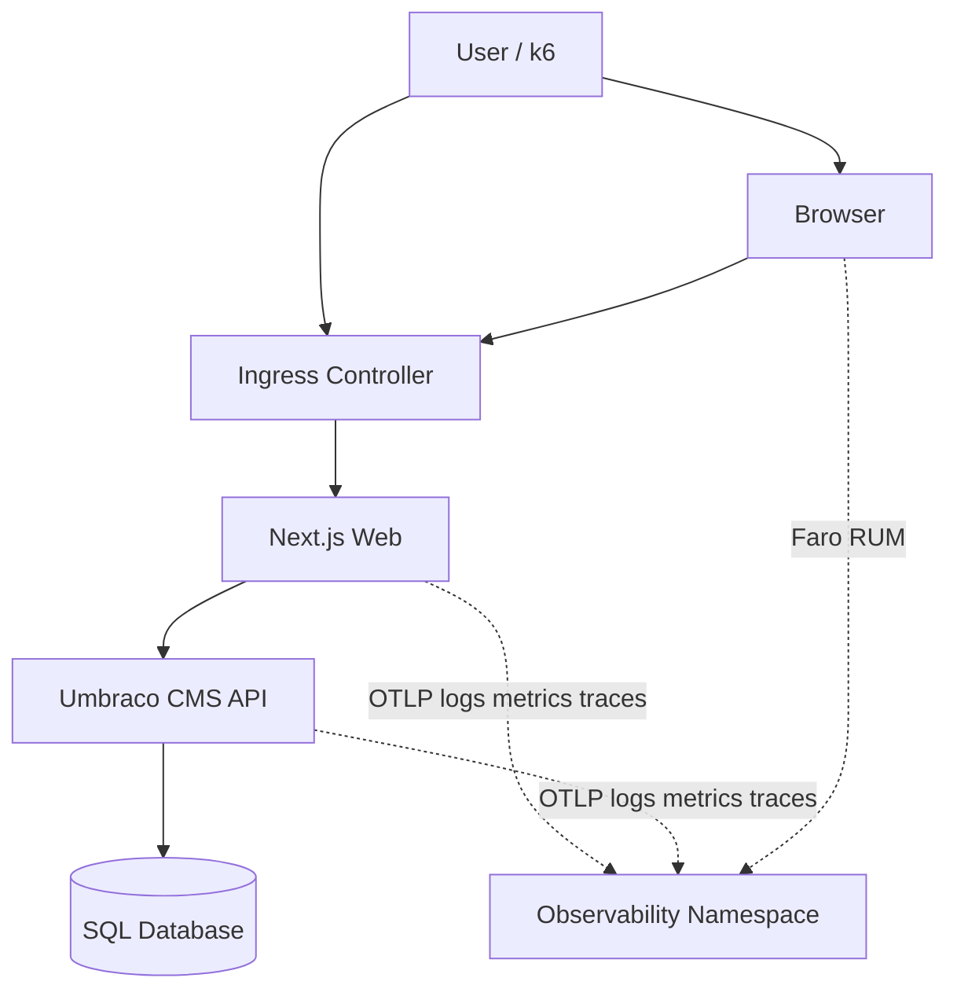

# Architecture

Target architecture for the **umbraco-monitoring** demo: applications, data, Kubernetes, observability.

**Implementation status:** Phases 0–5 complete (apps in `demo-services`, LGTM+ in `observability`, OTLP/Faro/Alloy/Pyroscope on apps). Phase 6+ adds full k6 load testing and dashboards.

---

## Context (C4 Level 1)



---

## Services

| Service | Technology | Responsibility |
|---------|------------|----------------|
| `umbraco-web` | Next.js | SSR/ISR, BFF route handlers, UI, Faro, OTel (Phase 5 ✅) |
| `umbraco-cms` | Umbraco headless | Delivery API, search, media, admin (seed) |
| `umbraco-db` | SQL Server | Umbraco persistence |

**Observability names (`service.name`):** `umbraco-web`, `umbraco-cms`.

---

## Data flows

### Content (runtime)

1. User opens `/articles` → Next.js server component
2. Server fetches `CMS_BASE_URL/umbraco/delivery/api/v2/content/...` (or BFF `/api/articles`)
3. JSON response → HTML render
4. Client hydration for interactivity (search input, pagination)

### Search

1. `GET /search?q=` on web
2. Route handler → `GET /umbraco/api/search?q=` on CMS
3. Examine index query → JSON results

### Load (k6)

- **Direct to web Ingress** — typical user path (preferred)
- **Direct to CMS API** — backend / DB stress (separate scenario)

---

## Kubernetes layout

```
Cluster
├── namespace: sqlserver
│   ├── StatefulSet/mssql2025
│   └── Service LoadBalancer 10.255.0.101:1433 (cluster LB, e.g. MetalLB)
├── namespace: demo-services
│   ├── Deployment/umbraco-cms
│   ├── Deployment/umbraco-web
│   ├── Ingress (web + cms hosts)
│   └── Secret/ConfigMap
└── namespace: observability
    ├── Grafana
    ├── Mimir
    ├── Loki
    ├── Tempo
    ├── Pyroscope
    ├── Alloy (DaemonSet + Gateway)
    ├── MinIO (optional)
    └── Beyla DaemonSet (Phase 8)
```

### Networking

- Web → CMS: cluster DNS `demo-umbraco.demo-services.svc` (see app manifests)
- CMS → DB: `mssql2025.sqlserver.svc.cluster.local:1433` (in-cluster) or `10.255.0.101:1433` (external LB IP, local Docker Compose)
- Alloy: scrape pods in `demo-services` via annotations; OTLP ingress from apps
- Grafana: Ingress / port-forward only (not public internet without auth)

---

## Boundaries and principles

| Principle | Decision |
|-----------|----------|
| Headless | Frontend does not use Management API |
| BFF | Route handlers hide CMS URL from browser where needed |
| Cache | Next `revalidate` reduces CMS load; k6 scenarios account for warm/cold cache |
| Secrets | K8s Secrets (CMS connection string); locally `appsettings.Development.json`, `src/umbr-fe/.env.local` (gitignored) |
| Media | Umbraco media via CMS URL; Next `next/image` remotePatterns |

---

## Deployment environments

| Env | Purpose |
|-----|---------|
| `local` | Podman/Docker for apps; CMS → remote K8s SQL at `10.255.0.101:1433` (see `deployment/k8s/sqlserver/`) |
| `demo` | K8s cluster label `deployment.environment=demo` |

Extra envs (`staging`, `prod`) are not required for the learning demo.

---

## Observability component dependencies

See [MONITORING_STACK.md](./MONITORING_STACK.md) — detailed Alloy → Mimir/Loki/Tempo/Pyroscope diagram.

---

## Scaling (demo)

- **Web:** HPA 2–5 pods under k6 load
- **CMS:** 1–2 replicas (Umbraco media on shared PVC or S3 later)
- **Observability:** single replica OK for lab cluster; limit Mimir/Loki retention

---

## Future extensions (outside MVP)

- Redis for distributed cache
- CDN for media
- External Secrets Operator
- GitOps (Flux/Argo CD)

Do not implement without user request.
