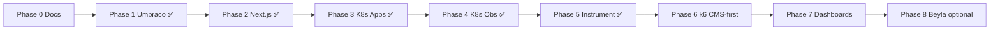

# Implementation plan

Phased plan with Definition of Done criteria. **Do not advance to the next phase** until the current phase criteria are met.

---

## Phase overview

| Phase | Name | Duration (estimate) | Observability in code |
|-------|------|---------------------|------------------------|
| 0 | Planning and AGENTS | ✅ done | None |
| 1 | Umbraco headless | ✅ done | Health only |
| 2 | Next.js + shadcn | ✅ done | Health only |
| 3 | Kubernetes (apps) | ✅ done | None |
| 4 | Kubernetes (obs stack) | ✅ done | Infra only |
| 5 | Instrumentation | ✅ done | Full |
| 6 | k6 load testing (CMS-first) | ✅ scripts + baseline | Uses full stack |
| 7 | Dashboards and demo | 3–4 days | Alerts |
| 8 | Beyla + hardening | 2–3 days | eBPF |

**Order rationale:** deploy apps and the LGTM+ stack, wire OTel/Faro/Alloy, **then** run the full k6 programme so load exercises real metrics, traces, logs, profiles, and RUM — not only smoke checks.

---

## Phase 0 — Planning (complete)

### Goal

Lock architecture, application specs, monitoring stack, and agent rules.

### Tasks

- [x] `AGENTS.md`, `README.md`
- [x] `docs/ARCHITECTURE.md`
- [x] `docs/APPLICATION_SPEC.md`
- [x] `docs/MONITORING_STACK.md`
- [x] `docs/K6_LOAD_TESTING.md`
- [x] `docs/API_CMS.md`, `docs/BASELINE.md`, `docs/DEMO_SCRIPT.md` (stubs where noted)
- [x] `deployment/k8s/sqlserver/README.md`
- [x] `.cursor/rules/`, `.cursor/skills/`

### DoD

- Agent can start Phase 1 without extra repo structure clarifications
- Default DB: **SQL Server** in remote K8s (PostgreSQL only if user explicitly requests a change)

### Default decisions (unless user specifies otherwise)

| Question | Default |
|----------|---------|
| Umbraco DB | SQL Server StatefulSet in remote K8s (`deployment/k8s/sqlserver/`) |
| Local dev | Docker Compose for apps; no local .NET; SQL via port-forward |
| Local K8s | kind or k3d |
| Ingress | nginx-ingress |
| .NET | LTS (8 or 10 — pin when creating solution) |
| Umbraco | Current LTS compatible with chosen .NET |

---

## Phase 1 — Umbraco headless (complete)

### Goal

Full headless CMS with Delivery API, demo content, and load-friendly endpoints.

### Tasks

1. [x] Solution in `src/umbraco/` (ASP.NET Core + Umbraco 17.4.2, `global.json`)
2. [x] Content types (see [APPLICATION_SPEC](./APPLICATION_SPEC.md)):
   - `article` (title, slug, excerpt, body, featuredImage, category, publishDate, author)
   - `category` (name, slug, description)
   - `author` (name, slug, bio, avatar media)
   - `siteSettings` (singleton)
3. [x] Delivery API: article list/detail, filter by category, pagination
4. [x] Search: Examine/Lucene endpoint `GET /umbraco/api/search?q=`
5. [x] Media: seed images; Delivery API media URLs
6. [x] Optional “heavy” endpoint for k6: `GET /umbraco/api/demo/slow?delayMs=` (dev/demo only, feature flag)
7. [x] `GET /health`, `GET /ready` (DB ping)
8. [x] Structured logging to stdout (`requestId`; no trace_id until Phase 5)
9. [x] Seed: `DemoContentSeedHostedService` — 100 articles, 5 categories, 10 authors, media
10. [x] Multi-stage `Containerfile` (see `src/umbraco/README.md`)
11. [x] CMS: `appsettings` + `appsettings.Development.json.example`; web: `src/umbr-fe/.env.example` (see READMEs)

**Phase 3 (done):** `deployment/k8s/apps/umbraco/` + [`.github/workflows/umbraco-container.yml`](../.github/workflows/umbraco-container.yml) — `https://demo-cms.1node.tech`.

### Do not in Phase 1

- OpenTelemetry, Prometheus exporter, Faro
- Helm observability
- Next.js

### DoD

- [x] Locally: Podman/Docker run + seed → Delivery API returns content (no host .NET SDK required)
- [x] `/health` → 200, `/ready` → 200 when DB is available
- [x] Docker image builds (CI: `umbraco-container.yml`; GHCR)
- [x] `docs/API_CMS.md` with request examples
- [x] ≥3 request types suitable for k6 (Delivery list/detail, search, demo slow/fault)

---

## Phase 2 — Next.js frontend (complete)

### Goal

Public site on Next.js + shadcn consuming Umbraco Delivery API, with routes for k6.

### Tasks

1. [x] App in `src/umbr-fe/` (Next.js, TypeScript, Tailwind, shadcn init)
2. [x] Pages:
   - `/` — hero + latest articles
   - `/articles` — paginated list with optional `?category=` filter
   - `/articles/[slug]` — detail
   - `/search?q=` — search (CMS search API)
   - `/about` — static content from siteSettings
3. [x] Route Handlers (BFF):
   - `GET /api/articles`, `GET /api/articles/[slug]`, `GET /api/search`
   - Cache: `revalidate` 60s for lists, 300s for details (configurable)
4. [x] UI: shadcn Card, Button, Input, Skeleton, Pagination
5. [x] `GET /api/health` for probes
6. [x] Env: `CMS_BASE_URL`, `NEXT_PUBLIC_SITE_URL`
7. [x] `Dockerfile` (standalone output)
8. [x] Error boundary, 404 for unknown slug
9. [x] K8s + CI (Phase 3): `deployment/k8s/apps/umbr-fe/`, [`.github/workflows/umbr-fe-container.yml`](../.github/workflows/umbr-fe-container.yml); prod `https://demo-umbr-fe.1node.tech`

### Do not in Phase 2

- Faro, OTel browser
- Grafana

### DoD

- [x] `npm run build` succeeds
- [x] All spec pages work against CMS (local + prod Delivery API)
- [x] `src/umbr-fe/Dockerfile` (standalone); Podman/GHCR image builds
- [x] Prod: `https://demo-umbr-fe.1node.tech` — pages, BFF, CMS media via `/_next/image` (hairpin NAT on router)
- [x] Lighthouse is not a goal; functionality and SSR/ISR matter more

---

## Phase 3 — Kubernetes (applications) (complete)

### Goal

Umbraco + Web + DB + Ingress in cluster; no observability namespace.

### Tasks

1. [x] SQL Server in `deployment/k8s/sqlserver/` — namespace `sqlserver`, LB IP `10.255.0.101` (cluster MetalLB configured separately)
2. [x] `deployment/k8s/apps/namespace.yaml` — namespace `demo-services` (CI/runbook default)
3. [x] Umbraco Deployment + Service + PVC (media/local temp); DB connection to `mssql2025.sqlserver.svc` or `10.255.0.101` — `deployment/k8s/apps/umbraco/`
4. [x] Web Deployment + Service — `deployment/k8s/apps/umbr-fe/` (`demo-services`)
5. [x] Ingress — Traefik `demo-umbr-fe.1node.tech` (+ CMS host; see runbook)
6. [x] ConfigMap for web (no Secret required)
7. [x] HPA for web (CPU 70%, min 2 max 5)
8. [x] `docs/RUNBOOK_LOCAL_K8S.md` — remote cluster deploy, verify, port-forward

No root Kustomization required — apply `umbraco/` and `umbr-fe/` separately with `-n demo-services`.

### DoD

- [x] Namespace `demo-services` applied (manifest in repo; CI deploy target)
- [x] Umbraco + web pods Ready; Ingress serves frontend and CMS API — prod: `https://demo-cms.1node.tech`, `https://demo-umbr-fe.1node.tech` (health/ready/Delivery API verified)
- [x] Rollout restart does not break readiness (verified on deploy cluster)
- [x] k6 is **not** required in this phase (full load testing is **Phase 6**, after instrumentation)

---

## Phase 4 — Kubernetes (observability stack) (complete)

### Goal

Deploy LGTM+ stack in namespace `observability`; apps do **not** send traces yet (except connectivity checks).

### Tasks

1. [x] Choose approach: separate Grafana Helm charts + in-cluster MinIO (documented in `deployment/k8s/observability/README.md`)
2. [x] Helm values: Mimir, Loki, Tempo, Pyroscope, Grafana, Alloy (DaemonSet + gateway)
3. [x] Components manifests / install script:
   - Grafana (admin creds in secret)
   - Mimir (remote_write via gateway)
   - Loki, Tempo, Pyroscope
   - Grafana Alloy (DaemonSet + gateway Deployment + Service `alloy-gateway:4317`)
   - MinIO for Mimir/Loki/Tempo blocks
4. [x] `docs/RUNBOOK_OBSERVABILITY.md` updated
5. [x] Deploy to cluster and verify DoD (Grafana UI, datasources, Alloy, Pyroscope)

NetworkPolicies are **out of scope** for this demo (default cluster networking is sufficient).

### DoD

- [x] Grafana UI reachable (ingress or port-forward)
- [x] Mimir/Loki/Tempo/Pyroscope datasources in Grafana → Connections
- [x] Alloy + alloy-gateway running (placeholder config OK)
- [x] Pyroscope UI/API reachable

---

## Phase 5 — Application instrumentation and Alloy

**Status:** ✅ Complete (May 2026). Code, Alloy pipeline, and cluster DoD verified per [run-docs/10-grafana-explore-cheatsheet.md](../run-docs/10-grafana-explore-cheatsheet.md). Follow-ups under load: Pyroscope `umbraco-web` ingest and 100% trace propagation → Phase 6 correlation checklist.

### Goal

End-to-end metrics, logs, traces, profiles, RUM.

### Tasks

### 5.1 Umbraco / .NET

- OpenTelemetry: ASP.NET Core, HttpClient, SQL
- OTLP exporter → Alloy gateway Service
- `ActivitySource` for custom spans (search, slow demo)
- Prometheus scrape annotations **or** OTLP metrics pipeline only
- Pyroscope .NET SDK continuous profiling
- Logs: Serilog → JSON stdout with `trace_id`/`span_id` (log correlation)

### 5.2 Next.js

- `@opentelemetry/sdk-node` or Vercel OTel pattern for Node server
- Route handlers: spans for CMS fetch
- Faro: `@grafana/faro-web-sdk` + `@grafana/faro-web-tracing`
- Faro collector endpoint (Alloy `faro.receiver` or Grafana Faro collector)

### 5.3 Alloy

- `prometheus.scrape` for annotated pods
- `otelcol.receiver.otlp` → `otelcol.exporter.otlp` (Tempo)
- `loki.source.kubernetes` or filelog for container logs
- `prometheus.remote_write` → Mimir
- `pyroscope.receive_http` / scrape config

### 5.4 Service graph

- `service.name`: `umbraco-cms`, `umbraco-web`
- `deployment.environment`: `demo`

### DoD

- [x] Trace browser → web → cms → sql visible in Tempo (Grafana Explore; reference trace `17434daa31df939a5b910737acc3054a`; not on every request)
- [x] CMS logs contain `trace_id` matching Tempo; web JSON logs with `trace_id` on SERVER spans (see [run-docs/11-logs-and-trace-correlation.md](../run-docs/11-logs-and-trace-correlation.md))
- [x] RED metrics for both services in Mimir (`http_server_request_duration_seconds_*` CMS, `http_server_duration_milliseconds_*` web)
- [x] Profiles in Pyroscope for .NET (`umbraco-cms`); Node SDK deployed — **re-validate `umbraco-web` flames under Phase 6 k6**
- [x] Faro sessions/events in Loki (`sdk_name=faro-web`; POST `/api/faro` → 202)

---

## Phase 6 — k6 load testing (CMS-first)

### Goal

**Full** load-testing programme against the instrumented stack — **CMS/.NET primary**, web secondary. Prove SLOs, record baselines, and drive visible signals in Grafana. Article narrative: intentional antipatterns **A** (N+1 `articles-naive`) and **D** (`demo/slow`) discovered via LGTM+.

### Scope (required)

Implement everything in [K6_LOAD_TESTING](./K6_LOAD_TESTING.md):

| Scenario | Role |
|----------|------|
| `cms-smoke.js` | Primary CI / quick CMS regression (~1 min) |
| `cms-load.js` | Main CMS mixed workload (~10 min, ramp VUs) |
| `cms-stress.js` | Find degradation / limits |
| `cms-spike.js` | Sudden traffic burst |
| `cms-direct.js` | CMS-only isolation (same mix, fixed VUs) |
| `web-smoke.js` / `web-load.js` | Secondary FE coverage (no article emphasis) |
| `load/k6/lib/` | Shared helpers (URLs, checks, tags) |
| `load/k6/data/` | `slugs.json`, `search-terms.json` from seed |

Demo endpoints: `Demo__NaiveArticlesEndpoint` (A), `Demo__SlowEndpoint` (D) — see [API_CMS](./API_CMS.md).

### Tasks

1. Implement all scenario files under `load/k6/`
2. Thresholds per scenario; tune after first runs on k8s Ingress URLs
3. Runners: `scripts/k6-cms-*.ps1`, `scripts/k6-web-*.ps1` (Podman fallback via `-UsePodman`)
4. Fill `docs/BASELINE.md` — primary: **CMS** (`demo-cms`); secondary: web
5. Correlation checklist: `cms-load.js` → RED in Mimir, traces in Tempo (incl. N+1 fan-out when naive on), logs with `trace_id`, Pyroscope; A/D flag runs
6. Optional: k6 Prometheus remote write — not required

### Do not in Phase 6

- Treat smoke as sufficient for phase closure
- Make frontend the primary load story for the Umbraco article
- Run full stress/spike as blocking CI on every PR (nightly/manual only)

### DoD

- [x] **cms-smoke** — exit 0 on k8s Ingress URLs (&lt; 2 min)
- [x] **cms-load** — 10 min run meets thresholds in K6 doc
- [x] **cms-stress** and **cms-spike** — scripts run to completion; knee point / failure mode documented (no strict p95)
- [x] **cms-direct** — exit 0; isolates CMS in Grafana
- [x] **web-smoke** (and short web-load) — exit 0 (secondary)
- [x] `docs/BASELINE.md` filled (RPS, p95, error rate per CMS scenario)
- [x] Correlation checklist documented (baseline runs done; A/D after enabling demo flags on **deployed** CMS with naive endpoint)
- [x] New load-bearing routes update [K6_LOAD_TESTING](./K6_LOAD_TESTING.md) and scenarios (`articles-naive`)

---

## Phase 7 — Dashboards, alerts, demo script

### Goal

Presentation-ready story: “load → signals → investigation” (app RED → pod resources → cluster).

### Tasks

1. [x] Grafana dashboards as code (`observability/grafana/dashboards/`) + sidecar ConfigMaps
   - RED: `umbraco-cms-red`, `umbraco-web-red`, `load-test-overview`
   - CMS runtime: `umbraco-cms-runtime`
   - Pod resources (cAdvisor): `k8s-pod-resources`
   - Cluster (node-exporter + kube-state-metrics): `k8s-cluster-overview`
2. [x] Alloy DaemonSet: kubelet cAdvisor scrape (demo-services/sqlserver) + scrape cluster exporters
3. [x] Cluster exporters: `cluster-metrics/` (node-exporter, kube-state-metrics Helm values)
4. [ ] Recording rules / alerts (optional Alertmanager) — deferred
5. [x] `docs/DEMO_SCRIPT.md` — step-by-step with dashboard UIDs
6. Correlation: Loki → Tempo, Tempo → Pyroscope (Grafana Explore) — datasources already wired

### DoD

- [x] Demo script reproducible from [DEMO_SCRIPT.md](./DEMO_SCRIPT.md)
- [x] Dashboards provisioned as code; under k6 load, CMS RED / overview update (verify after deploy)
- [x] Incident path documented (naive / slow / fault) in DEMO_SCRIPT + run-docs/12
- [ ] Live verify on cluster after `helm upgrade` Grafana + Alloy + `install-cluster-metrics.ps1`

---

## Phase 8 — Beyla and hardening (optional)

### Goal

eBPF auto-instrumentation without code changes; production-minded tweaks.

### Tasks

- Beyla DaemonSet: annotations on web/cms pods
- Compare Beyla vs OTel traces (document differences)
- Resource tuning after k6 stress
- Backup Grafana dashboards

### DoD

- [ ] Beyla spans in Tempo for HTTP (if enabled)
- [ ] Document `docs/BEYLA_VS_OTEL.md`

---

## CI/CD (cross-cutting, add per phase)

| Phase | CI |
|-------|-----|
| 1 | `umbraco-container.yml` (build/push GHCR, deploy K8s); optional `dotnet test` later |
| 2 | `npm ci`, `lint`, `build` |
| 3–4 | Build images, push registry, deploy workflows |
| 6 | k6 smoke on PR (optional); load/stress nightly or manual |

Use skills: `gh-actions-dotnet-build`, `gh-actions-nodejs-build`, `ci-cd-pipeline-foundation`.

---

## Risks and mitigations

| Risk | Mitigation |
|------|------------|
| Umbraco + SQL heavy in K8s | PVC sizing; external managed DB |
| Mimir storage | MinIO in cluster; 7d retention for demo |
| Trace volume | 10–20% sampling on load, 100% on smoke |
| Faro CORS | Alloy/gateway config + same-site ingress |
| Flaky k6 in CI | Thresholds with margin; separate nightly job |

---

## Next step for the agent

**Phase 7:** dashboards + exporters are in repo. Deploy: upgrade Grafana (sidecar), Alloy DaemonSet, `scripts/apply-grafana-dashboards.ps1`, `scripts/install-cluster-metrics.ps1`; then verify under `cms-load`. Optional: Alertmanager rules; CMS `articles-naive` deploy for A/D screenshots ([run-docs/12](../run-docs/12-cms-load-correlation.md)).

Phases **0–6** scripts/baselines complete; Phase 7 as-code ready (live cluster verify pending). Phase 5 journal: [run-docs/09-phase-5-instrumentation.md](../run-docs/09-phase-5-instrumentation.md).

User must explicitly name the phase before mixing work from other phases.
