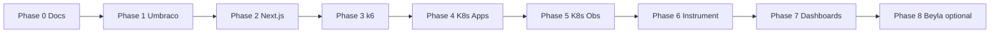

# Implementation plan

Phased plan with Definition of Done criteria. **Do not advance to the next phase** until the current phase criteria are met.

---

## Phase overview

| Phase | Name | Duration (estimate) | Observability in code |
|-------|------|---------------------|------------------------|
| 0 | Planning and AGENTS | ✅ current | None |
| 1 | Umbraco headless | 3–5 days | Health only |
| 2 | Next.js + shadcn | 3–5 days | Health only |
| 3 | k6 load testing | 2–3 days | None |
| 4 | Kubernetes (apps) | 2–4 days | None |
| 5 | Kubernetes (obs stack) | 3–5 days | Infra only |
| 6 | Instrumentation | 4–6 days | Full |
| 7 | Dashboards and demo | 3–4 days | Alerts |
| 8 | Beyla + hardening | 2–3 days | eBPF |

---

## Phase 0 — Planning (current)

### Goal

Lock architecture, application specs, monitoring stack, and agent rules.

### Tasks

- [x] `AGENTS.md`, `README.md`
- [x] `docs/ARCHITECTURE.md`
- [x] `docs/APPLICATION_SPEC.md`
- [x] `docs/MONITORING_STACK.md`
- [x] `docs/K6_LOAD_TESTING.md`
- [x] `.cursor/rules/`, `.cursor/skills/`

### DoD

- Agent can start Phase 1 without extra repo structure clarifications
- User confirmed: **SQL Server** or **PostgreSQL** (see defaults below)

### Default decisions (unless user specifies otherwise)

| Question | Default |
|----------|---------|
| Umbraco DB | SQL Server StatefulSet in remote K8s (`deployment/k8s/sqlserver/`) |
| Local dev | Docker Compose for apps; no local .NET; SQL via port-forward |
| Local K8s | kind or k3d |
| Ingress | nginx-ingress |
| .NET | LTS (8 or 10 — pin when creating solution) |
| Umbraco | Current LTS compatible with chosen .NET |

---

## Phase 1 — Umbraco headless (sample CMS)

### Goal

Full headless CMS with Delivery API, demo content, and load-friendly endpoints.

### Tasks

1. Solution in `src/umbraco/` (ASP.NET Core + Umbraco 17.4.2)
2. Content types (see [APPLICATION_SPEC](./APPLICATION_SPEC.md)):
   - `article` (title, slug, body, category, publishDate, author)
   - `category` (name, slug)
   - `author` (name, bio, avatar media)
   - `siteSettings` (singleton)
3. Delivery API: article list/detail, filter by category, pagination
4. Search: Examine/Lucene endpoint `GET /umbraco/api/search?q=`
5. Media: seed images; Delivery API media URLs
6. Optional “heavy” endpoint for k6: `GET /umbraco/api/demo/slow?delayMs=` (dev/demo only, feature flag)
7. `GET /health`, `GET /ready` (DB ping)
8. Structured logging to stdout (no trace_id until Phase 6)
9. Seed: CLI or one-shot `IHostedService` — N articles (≥100), 5 categories, 10 authors
10. Multi-stage `Dockerfile`
11. `.env.example`, `appsettings.Development.json` template

### Do not in Phase 1

- OpenTelemetry, Prometheus exporter, Faro
- Helm observability
- Next.js

### DoD

- [ ] Locally: `dotnet run` + seed → Delivery API returns content
- [ ] `/health` → 200, `/ready` → 200 when DB is available
- [ ] Docker image builds
- [ ] Postman/curl collection or `docs/API_CMS.md` with request examples
- [ ] ≥3 request types suitable for k6 (list, detail, search)

---

## Phase 2 — Next.js frontend (sample web)

### Goal

Public site on Next.js + shadcn consuming Umbraco Delivery API, with routes for k6.

### Tasks

1. App in `src/web/` (Next.js, TypeScript, Tailwind, shadcn init)
2. Pages:
   - `/` — hero + latest articles
   - `/articles` — paginated list with optional `?category=` filter
   - `/articles/[slug]` — detail
   - `/search?q=` — search (CMS search API)
   - `/about` — static content from siteSettings
3. Route Handlers (BFF if needed):
   - `GET /api/articles`, `GET /api/articles/[slug]`, `GET /api/search`
   - Cache: `revalidate` 60s for lists, 300s for details (configurable)
4. UI: shadcn Card, Button, Input, Skeleton, Pagination
5. `GET /api/health` for probes
6. Env: `CMS_BASE_URL`, `NEXT_PUBLIC_SITE_URL`
7. `Dockerfile` (standalone output)
8. Error boundary, 404 for unknown slug

### Do not in Phase 2

- Faro, OTel browser
- Grafana

### DoD

- [ ] `npm run build` succeeds
- [ ] All spec pages work against local CMS
- [ ] Docker image builds
- [ ] Lighthouse is not a goal; functionality and SSR/ISR matter more

---

## Phase 3 — k6 load testing

### Goal

Reproducible load before and after monitoring; baseline SLOs.

### Tasks

1. `load/k6/` — smoke, load, stress, spike (see [K6_LOAD_TESTING](./K6_LOAD_TESTING.md))
2. Thresholds for smoke/load
3. Script `make load-smoke` or `npm run k6:smoke` / `pwsh ./scripts/k6-smoke.ps1`
4. Document baseline RPS and p95 **without** observability overhead
5. Optional: k6 cloud output — not required

### DoD

- [ ] Smoke < 2 min, exit 0 on docker-compose or local URLs
- [ ] Load 10 min stably meets target RPS (see K6 doc)
- [ ] Baseline recorded in `docs/BASELINE.md`

---

## Phase 4 — Kubernetes (applications)

### Goal

Umbraco + Web + DB + Ingress in cluster; no observability namespace.

### Tasks

1. SQL Server in `deployment/k8s/sqlserver/` — namespace `sqlserver`, LB IP `10.255.0.101` (cluster MetalLB configured separately)
2. `deployment/k8s/apps/namespace.yaml` — namespace `umbraco-demo`
3. Umbraco Deployment + Service + PVC (media/local temp); DB connection to `mssql2025.sqlserver.svc` or `10.255.0.101`
4. Web Deployment + Service
5. Ingress: `cms.demo.local`, `web.demo.local` (or single host with path prefix)
6. ConfigMaps/Secrets from examples
7. HPA for web (CPU 70%, min 2 max 5) — optional for demo
8. `docs/RUNBOOK_LOCAL_K8S.md` — kind/k3d up, deploy, port-forward

### DoD

- [ ] `kubectl apply -f deployment/k8s/apps/` brings up the stack
- [ ] Ingress serves frontend and CMS API
- [ ] k6 smoke against Ingress URL — exit 0
- [ ] Rollout restart does not break readiness

---

## Phase 5 — Kubernetes (observability stack)

### Goal

Deploy LGTM+ stack in namespace `observability`; apps do **not** send traces yet (except connectivity checks).

### Tasks

1. Choose approach: **kube-prometheus-stack** + extra charts **or** Grafana helm charts (Mimir distributed / single binary, Loki, Tempo, Pyroscope)
2. Recommended for demo: [Grafana k8s monitoring helm](https://github.com/grafana/k8s-monitoring-helm) **or** separate official charts — document in `deploy/k8s/observability/README.md`
3. Components:
   - Grafana (admin creds in secret)
   - Mimir (or Prometheus remote_write → Mimir)
   - Loki
   - Tempo
   - Pyroscope
   - Grafana Alloy (DaemonSet + optional gateway Deployment)
4. NetworkPolicies: observability can scrape apps namespace
5. MinIO/S3 for Mimir/Loki blocks storage — prod-like demo (single-node MinIO in cluster is OK)
6. `docs/RUNBOOK_OBSERVABILITY.md`

### DoD

- [ ] Grafana UI reachable (ingress or port-forward)
- [ ] Mimir/Loki/Tempo healthy in Grafana → Connections
- [ ] Alloy pod running (placeholder config OK)
- [ ] Pyroscope UI/API reachable

---

## Phase 6 — Application instrumentation and Alloy

### Goal

End-to-end metrics, logs, traces, profiles, RUM.

### Tasks

### 6.1 Umbraco / .NET

- OpenTelemetry: ASP.NET Core, HttpClient, SQL
- OTLP exporter → Alloy gateway Service
- `ActivitySource` for custom spans (search, slow demo)
- Prometheus scrape annotations **or** OTLP metrics pipeline only
- Pyroscope .NET SDK continuous profiling
- Logs: Serilog → JSON stdout with `trace_id`/`span_id` (log correlation)

### 6.2 Next.js

- `@opentelemetry/sdk-node` or Vercel OTel pattern for Node server
- Route handlers: spans for CMS fetch
- Faro: `@grafana/faro-web-sdk` + `@grafana/faro-web-tracing`
- Faro collector endpoint (Alloy `faro.receiver` or Grafana Faro collector)

### 6.3 Alloy

- `prometheus.scrape` for annotated pods
- `otelcol.receiver.otlp` → `otelcol.exporter.otlp` (Tempo)
- `loki.source.kubernetes` or filelog for container logs
- `prometheus.remote_write` → Mimir
- `pyroscope.receive_http` / scrape config

### 6.4 Service graph

- `service.name`: `umbraco-cms`, `umbraco-web`
- `deployment.environment`: `demo`

### DoD

- [ ] Trace browser → web → cms → sql visible in Tempo (Grafana Explore)
- [ ] Web logs contain trace_id matching the trace
- [ ] RED metrics for both services in Mimir
- [ ] Profiles in Pyroscope for .NET and Node under k6 load
- [ ] Faro sessions/events in Grafana (Faro data source)

---

## Phase 7 — Dashboards, alerts, demo script

### Goal

Presentation-ready story: “load → signals → investigation”.

### Tasks

1. Grafana dashboards as code (`observability/grafana/dashboards/`)
   - RED per service
   - CMS: search latency, DB duration
   - Web: SSR duration, cache hit ratio (if metric exists)
   - k6 results (if exported to Prometheus)
   - Faro: Web Vitals, errors, sessions
2. Recording rules / alerts (optional Alertmanager)
   - High error rate, p95 latency, Loki error log rate
3. `docs/DEMO_SCRIPT.md` — step-by-step 15–20 min
4. Correlation: Loki → Tempo, Tempo → Pyroscope (Grafana Explore)

### DoD

- [ ] Demo script reproducible by someone else from the doc
- [ ] Under k6 load, dashboard changes visible in real time
- [ ] One “incident” (slow endpoint / fault injection) visible in traces+logs

---

## Phase 8 — Beyla and hardening (optional)

### Goal

eBPF auto-instrumentation without code changes; production-minded tweaks.

### Tasks

- Beyla DaemonSet: annotations on web/cms pods
- Compare Beyla vs OTel traces (document differences)
- Tighten NetworkPolicies
- Resource tuning after k6 stress
- Backup Grafana dashboards

### DoD

- [ ] Beyla spans in Tempo for HTTP (if enabled)
- [ ] Document `docs/BEYLA_VS_OTEL.md`

---

## CI/CD (cross-cutting, add per phase)

| Phase | CI |
|-------|-----|
| 1 | `dotnet build`, `dotnet test` |
| 2 | `npm ci`, `lint`, `build` |
| 3 | k6 smoke in pipeline (optional, nightly load) |
| 4+ | Build images, push registry, deploy workflow (manual approve) |

Use skills: `gh-actions-dotnet-build`, `gh-actions-nodejs-build`, `ci-cd-pipeline-foundation`.

---

## Risks and mitigations

| Risk | Mitigation |
|------|------------|
| Umbraco + SQL heavy in K8s | PVC sizing; external managed DB |
| Mimir storage | MinIO in cluster; 7d retention for demo |
| Trace volume | 10–20% sampling on load, 100% on smoke |
| Faro CORS | Alloy/gateway config + same-site ingress |
| Flaky k6 in CI | Thresholds with margin; separate nightly job |

---

## Next step for the agent

**Phase 1:** create `src/cms/` solution, content model, seed, health, Dockerfile — per [APPLICATION_SPEC](./APPLICATION_SPEC.md).

User must explicitly say “start Phase 1” or clarify DB/K8s target.
