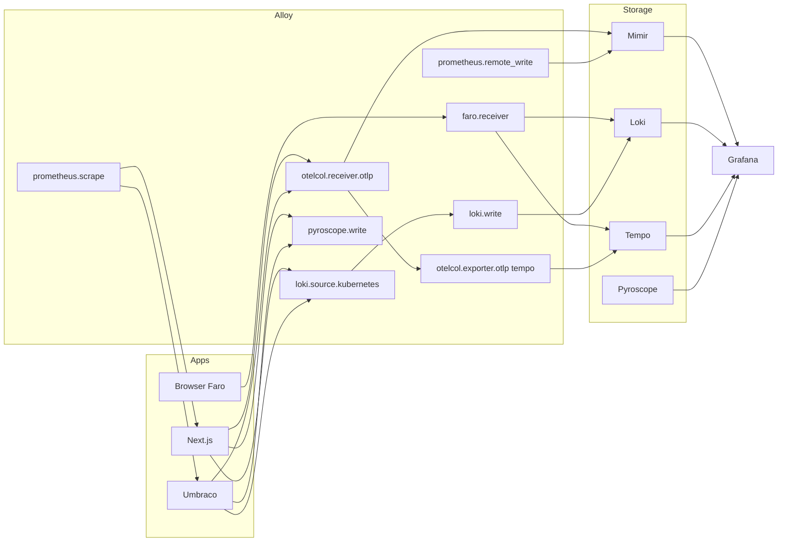

# Observability stack

Target **Grafana LGTM+** setup with **Alloy**, **Faro**, and optionally **Beyla** for the Umbraco + Next.js demo on Kubernetes.

**Deployment:** namespace `observability` — Mimir, Loki, Tempo, Pyroscope, Grafana, Alloy (DaemonSet + gateway), MinIO, OpenMaxIO (Phase 4 ✅). App OTLP/Faro/Pyroscope wiring (Phase 5 ✅). See [RUNBOOK_OBSERVABILITY.md](./RUNBOOK_OBSERVABILITY.md), [run-docs/10-grafana-explore-cheatsheet.md](../run-docs/10-grafana-explore-cheatsheet.md).

---

## Components

| Component | Role | Protocol / interface |
|-----------|------|----------------------|
| **Grafana** | UI, dashboards, Explore, correlation | HTTP |
| **Mimir** | Long-term metrics storage | Prometheus remote_write, PromQL |
| **Loki** | Log aggregation | LogQL push (Alloy) |
| **Tempo** | Distributed tracing | OTLP gRPC/HTTP |
| **Pyroscope** | Continuous profiling | HTTP push / scrape |
| **Grafana Alloy** | Collector: scrape, OTLP, logs, Faro | River config |
| **Grafana Faro** | RUM: Web Vitals, errors, sessions | Browser SDK → collector |
| **Beyla** (opt.) | eBPF auto HTTP traces | OTLP → Tempo |

---

## Pipeline (target diagram)

---

## Signals per service

### `umbraco-cms` (.NET)

| Signal | Source | Phase |
|--------|--------|-------|
| RED metrics | OTel → Mimir | 6 |
| ASP.NET request duration | OTel | 6 |
| SQL client duration | OTel | 6 |
| Logs | stdout JSON → Loki | 1 basic, 6 correlated |
| Traces | OTLP | 6 |
| Profiles | Pyroscope .NET SDK | 6 |
| eBPF HTTP | Beyla | 8 |

**Key spans:** Delivery API fetch, Search (Examine), DB query.

### `umbraco-web` (Node)

| Signal | Source | Phase |
|--------|--------|-------|
| RED metrics | OTel | 6 |
| SSR / route handler duration | OTel | 6 |
| CMS upstream HTTP | OTel HttpClient child span | 6 |
| Logs | stdout → Loki | 2+ when app exists, 6 correlated |
| Traces | OTLP | 6 |
| Profiles | Pyroscope Node | 6 |
| RUM | Faro | 6 |
| eBPF HTTP | Beyla | 8 |

**Key spans:** `GET /articles`, `fetch CMS`, render.

### Browser (Faro)

| Signal | Purpose |
|--------|---------|
| Web Vitals (LCP, INP, CLS) | UX under load |
| `faro.api` errors | JS/network failures |
| Session / view | Demo funnel |
| Trace link | W3C traceparent → Tempo |

---

## Labels and naming (required)

Consistent labels for Grafana correlation:

| Label | Example | Where |
|-------|---------|-------|
| `service.name` | `umbraco-cms`, `umbraco-web` | OTel resource |
| `service.namespace` | `demo-services` | OTel resource |
| `deployment.environment` | `demo` | OTel resource |
| `k8s.pod.name` | from downward API | Alloy logs |
| `http.route` | normalized template | OTel span |

**Do not use** high-cardinality labels: `user.id`, raw `article.slug` in metrics.

---

## Alloy (configuration — Phase 5 guide)

Files: `observability/alloy/config.alloy` (or ConfigMap `alloy-config`).

Minimum components:

1. `prometheus.scrape` — pods with `prometheus.io/scrape: "true"`
2. `prometheus.scrape` **cadvisor** — kubelet `/metrics/cadvisor` (filter `demo-services|sqlserver`)
3. `prometheus.scrape` **cluster_exporters** — node-exporter (:9100), kube-state-metrics (:8080)
4. `prometheus.remote_write` → Mimir gateway URL
5. `otelcol.receiver.otlp` `0.0.0.0:4317` / `4318`
6. `otelcol.processor.batch` → Tempo / Loki / Mimir
7. `loki.source.kubernetes` for `demo-services`
8. `faro.receiver` + `pyroscope.receive_http` on gateway

Gateway Service: `alloy-gateway.observability.svc:4317` (document in [RUNBOOK_OBSERVABILITY.md](./RUNBOOK_OBSERVABILITY.md)).

Cluster exporters: [deployment/k8s/observability/cluster-metrics/](../deployment/k8s/observability/cluster-metrics/).

---

## Grafana datasources

| Datasource | UID (recommended) | Type |
|------------|-------------------|------|
| Mimir | `mimir` | Prometheus |
| Loki | `loki` | Loki |
| Tempo | `tempo` | Tempo |
| Pyroscope | `pyroscope` | Grafana Pyroscope |
| Faro | `faro` | Grafana Faro |

Enable **correlations**: Loki → Tempo (trace_id), Tempo → Loki, Tempo → Pyroscope.

---

## Sampling and retention (demo)

| Parameter | Value |
|-----------|-------|
| Trace sampling | 100% smoke; 10–20% load test |
| Mimir metrics retention | 7d |
| Loki retention | 7d |
| Log volume | JSON info; debug off in demo |
| Profiles | 15s scrape / push interval |

---

## Dashboards (Phase 7 — list)

JSON in `observability/grafana/dashboards/`; apply ConfigMaps: `scripts/apply-grafana-dashboards.ps1` (Grafana sidecar, folder **Demo**).

| UID | Purpose |
|-----|---------|
| `load-test-overview` | CMS vs web RPS/p95 during k6 |
| `umbraco-cms-red` | CMS RED (seconds histograms) |
| `umbraco-cms-runtime` | .NET GC / thread pool / exceptions |
| `umbraco-web-red` | Web RED (millisecond histograms) |
| `k8s-pod-resources` | Pod CPU/mem (cAdvisor → Mimir) |
| `k8s-cluster-overview` | Nodes + kube-state (exporters) |

Faro RUM / k6 remote_write / Alertmanager — optional later.

---

## Alerts (minimum for demo)

| Alert | Condition | Demo purpose |
|-------|-----------|--------------|
| HighErrorRate | 5xx > 1% for 5m | fault endpoint |
| HighLatency | p95 > 1s for 5m | slow endpoint + k6 |
| LogErrorBurst | Loki `level=error` rate | incident |

---

## Beyla vs OTel (Phase 8)

| | OTel SDK | Beyla |
|---|----------|-------|
| Invasiveness | Code + deps | Annotations / DaemonSet |
| Detail | In-app spans | HTTP/K8s level |
| Use | Primary path | Comparison / supplement |

Document in `docs/BEYLA_VS_OTEL.md` after Phase 8.

---

## Kubernetes deployment

- Namespace: `observability`
- Preference: official Grafana Helm charts / `grafana/k8s-monitoring-helm`
- `deployment/k8s/observability/README.md` — chart versions, values overrides, `helm install` order

**Do not** mix observability manifests with `deployment/k8s/apps/` — different lifecycles.

---

## Stack readiness checklist

- [ ] PromQL: `http_server_request_duration_seconds` (or OTel metric name) for both services
- [ ] LogQL: `{service_name="umbraco-web"} |= "error"`
- [ ] TraceQL: `{ resource.service.name="umbraco-web" }`
- [ ] Pyroscope: flame graph under k6 load
- [ ] Faro: sessions > 0 during k6 browser scenario (if used)
